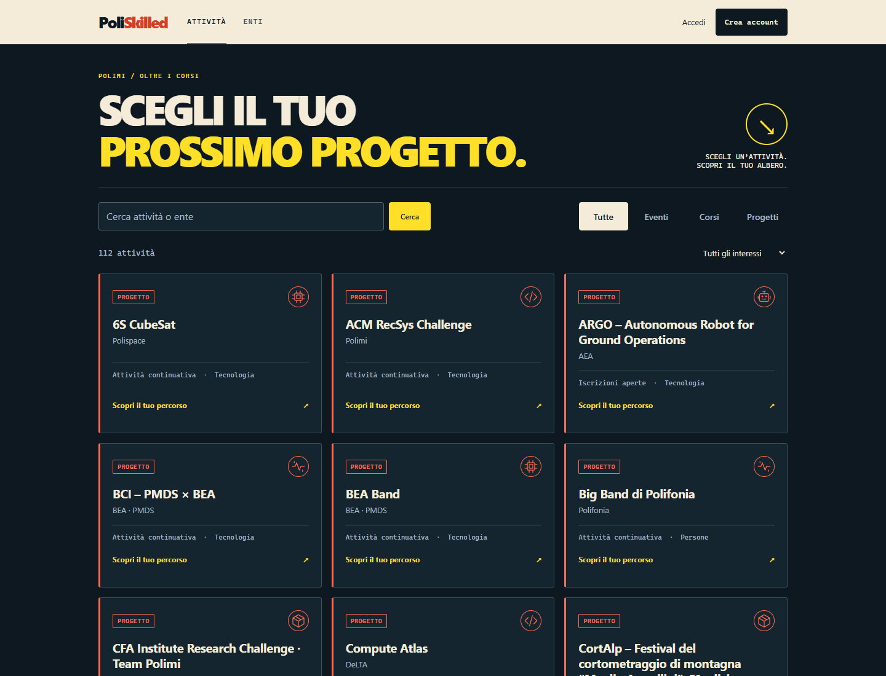
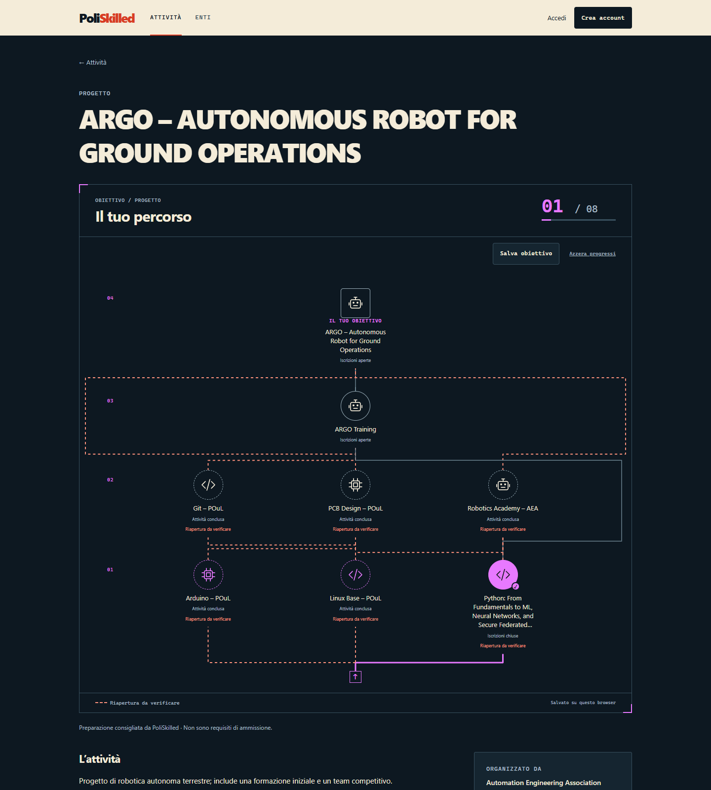

# PoliSkilled

**Scegli il tuo prossimo progetto.**

Eventi, corsi e progetti oltre le lezioni del Politecnico di Milano.
Una dashboard pubblica e skill tree per scoprire cosa fare, costruire il proprio
percorso e incontrare gli enti della community. Progetto indipendente, non affiliato al Politecnico.




## Cosa puoi fare

- **Esplora subito.** Ricerca, tre categorie, pochi tag e livelli suggeriti. Mobile first,
  colori pieni, nessun gradiente o immagine decorativa.
- **Costruisci il tuo percorso.** I collegamenti si generano dalle attività approvate:
  scegli un’attività come obiettivo. Chi propone seleziona icona e attività preparatorie;
  livelli, rami e colori si aggiornano da soli. Nessun percorso separato da creare.
- **Salva le tue scelte.** Completamenti e obiettivi salvati rimangono nel browser
  senza account; accedendo vengono sincronizzati. Profilo e preferenze si gestiscono dall'account.
- **Proponi con un ente.** Profilo con logo, attività condivise fra più enti, bozze e
  revisione con motivazioni, commenti e versioni. Una modifica pubblicata torna in revisione.
- **Gestisci la community.** I gestori verificano gli enti, approvano le proposte e cercano
  gli account per assegnare o rimuovere il ruolo di gestore. Nessuna auto-approvazione.
- **Leggi i risultati.** Visite e browser stimati per mese, interessi, completamenti e
  persone che hanno scelto ogni obiettivo e coinvolgimento nelle sue tappe. Ogni ente vede le proprie attività; i gestori hanno la vista globale.
  I report mostrano conteggi aggregati, senza liste di nomi o email dei partecipanti.

Politecnico di Milano è un ente. *Passion in Action* è un programma di corsi, che possono
essere proposti dal Poli insieme ad altri enti. Il catalogo contiene **112 attività reali**
e **49 enti**, verificati il **12 novembre 2026**: 38 Passion in Action, iniziative delle
associazioni e progetti competitivi. Le fonti e i limiti della ricerca sono in
[Fonti](docs/sources.md).

**50 obiettivi hanno preparazioni consigliate da PoliSkilled.** Sono collegamenti
editoriali fra attività reali, distinti dai requisiti ufficiali. Non certificano
competenze e non impongono di completare tutti i rami. Un corso con iscrizioni chiuse
rimane riconoscibile; il grafo non è un calendario di iscrizioni garantite.

## Avvio locale

Python 3.12, Node 22 per i test JavaScript e [uv](https://docs.astral.sh/uv/).

```bash
git clone https://github.com/andretosi/poliskilled.git
cd poliskilled
uv venv --python 3.12
uv pip install --python .venv/bin/python -r requirements-dev.txt
bash scripts/dev.sh
```

Apri http://127.0.0.1:8000. In fondo alla pagina, **Accessi demo** permette di provare
studente, ente e gestore senza password. Funziona solo in debug, su loopback e con il
flag demo: non è disponibile nell'anteprima remota o in produzione.
In WSL usa il filesystem Linux, per esempio `~/projects/poliskilled`.

La registrazione personale è libera. Registrare un ente crea una richiesta da
verificare; non consente di rivendicare un ente già esistente.
Se l’ente è già nel catalogo, il referente crea un account personale: un gestore
lo collega da **Gestione → Enti e referenti**, dopo averne verificato l’identità.
Il collegamento è registrato nello storico e non approva automaticamente l’ente.
Per abilitare il primo gestore, il responsabile del server esegue:

```bash
.venv/bin/python manage.py grant_site_admin nomeutente
```

I gestori successivi si aggiungono da **Gestione → Persone e ruoli**.
Il ruolo non concede accesso al pannello tecnico Django.

## Email e dati

Il recupero password usa i token Django e SMTP Resend. Occorrono un dominio verificato,
un mittente, `RESEND_API_KEY` e `POLISKILLED_PUBLIC_URL`: vedi [configurazione account](docs/accounts.md).
Senza configurazione la pagina lo dice chiaramente; nessun invio reale è simulato.
Gli aggiornamenti email sono facoltativi e senza spunta iniziale. Sono predisposti
consenso e verifica dell'indirizzo; l'invio di campagne non è incluso.

Le statistiche iniziano all'attivazione. “Visitatori” indica **browser stimati**, non
persone identificate. Identificativi separati dagli account, rotazione mensile, digest
eliminati dopo 40 giorni e aggregati conservati per 24 mesi.
[Significato dei dati e pulizia](docs/analytics.md).

## Codice e contributi

Django con pagine server-rendered, SQLite su singolo host, CSS e JavaScript essenziale.
Nessun framework frontend o passaggio di build per aprire il sito.

| Cartella | Contenuto |
| --- | --- |
| `poliskilled/` | Impostazioni e URL del progetto |
| `hub/` | Catalogo, proposte, enti, moderazione e skill tree |
| `accounts/` | Profilo, preferenze ed email |
| `insights/` | Obiettivi salvati e statistiche |
| `templates/`, `static/` | Interfaccia e interazioni |
| `deploy/` | Esempi per servizio, proxy HTTPS e pulizia periodica |

Ogni persona usa una branch propria per una feature piccola. Dopo verifica si integra
direttamente in `main`, che rappresenta la versione distribuibile.

```bash
git switch main
git switch -c andrea/nome-feature
# implementa e verifica
bash scripts/check.sh
git add <file-della-feature>
git commit -m "Descrivi il cambiamento"
git switch main
git merge --ff-only andrea/nome-feature
```

Worktree facoltativo:
`git worktree add ../poliskilled-feature -b andrea/nome-feature main`.
Ambiente e database sono separati per worktree. Se main avanza, aggiorna la branch
personale, risolvi i conflitti e verifica prima del merge.

[Regole](AGENTS.md) · [Decisioni del brief](agents.py) · [Task](docs/objective-work.md)

## Verifica e distribuzione

```bash
bash scripts/check.sh
.venv/bin/pip-audit -r requirements.txt
.venv/bin/python scripts/check_production.py
```

La suite usa database e storage isolati. La CI esegue i controlli su push e pull request.
Per installazione e aggiornamenti: [deploy](docs/deployment.md).
Per consultare da telefono tramite la propria rete privata: [Tailscale](docs/remote-preview.md).
Il deploy automatico richiede un hosting e i relativi segreti, ancora da scegliere.

## Licenza e nome

Codice sotto [Apache 2.0](LICENSE): uso, modifica e distribuzione, anche commerciale.
La licenza del codice non concede il marchio **PoliSkilled**, il logo o l'identità visiva
del progetto. Per pubblicare un fork scegli un altro nome: [policy del marchio](TRADEMARKS.md).
Nomi e loghi degli enti rimangono dei rispettivi titolari.

With love from [Andrea Tosi](https://github.com/andretosi).
